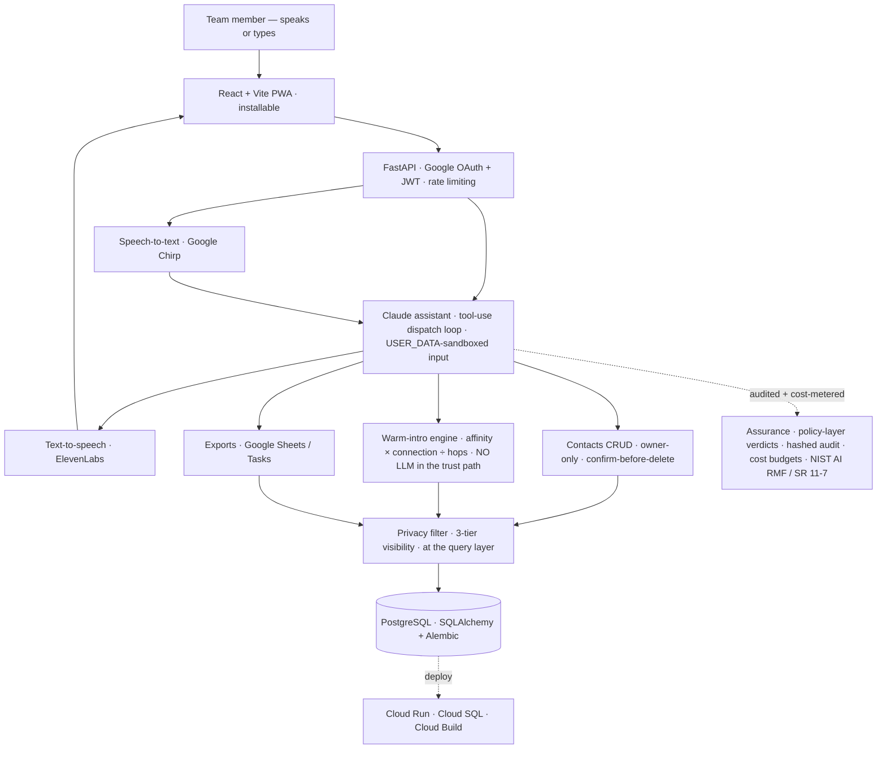

# DESS CRM

[](https://github.com/leighanne77/DESS/actions/workflows/ci.yml)

Voice-first team CRM **+ a deterministic warm-introduction engine** for **DIN — the Dual-Use Investor Network.**

> **About this repository.** This is the **public tree** of a system that also runs
> privately in production for a small investor team. It is not a copy: the public code is
> authored here and published from here, behind a **gate that fails the build** if an
> identifier belonging to the private deployment appears anywhere in it
> (`tests/test_public_tree_is_deidentified.py`). Nothing is redacted on the way out,
> because nothing makes the trip. The cast is **fictional throughout**
> (`scripts/seed_dummy_data.py`) and the whole thing clones and runs end-to-end against
> it. It's here to show the engineering — not to expose a live deployment or any real data.

> **Three companion documents:** [`PHILOSOPHY.md`](PHILOSOPHY.md) — the
> operating principles, for the human reader — and [`CLAUDE.md`](CLAUDE.md),
> the same discipline expressed as an enforceable contract for any coding
> agent working in this repository — and [`ROADMAP.md`](ROADMAP.md), an
> advance copy of the next major slice: one assistant becoming a crew of
> agents under the same registry.

## The build, in five claims

**A voice-interface CRM, live in production** for a stealth investor
network, running on real LP data — full stack, LLM ops (behavioral evals,
model-cost budgets, prompt-injection testing), on a cloud deployment with
tiered multi-user access.

**The governance layer LP data requires:** three-tier field handling
enforced at the query layer, a hashed-payload audit trail with field-level
diffs, encrypted credentials, an injection-test harness, and controls
mapped to **NIST AI RMF** and **SR 11-7**.

**Right-sized deliberately.** PostgreSQL throughout; **Spark was rejected
as over-scaled** for the data volume, and a heavier store would have been
theater.

**A graph-backed warm-introduction engine** in the same system:
deterministic, auditable path scoring (`affinity × connection ÷ hops`)
over a relationship graph held in PostgreSQL and **walked in memory,
bounded at two hops** — with hard safety gates the model cannot override.
**No LLM in the trust path.**

**The same discipline applied to the graph itself:** a graph database
(Neo4j) was evaluated and **deferred, with the revisit trigger written
down** — when path queries strain into millions of edges. At team scale,
in-memory enumeration is simpler, fully testable, and one less system to
secure. The decision record explains itself so a future team can overturn
it on evidence rather than fashion.

## 🛠️ Stack

> **No LLM in the trust path.** The model translates the request and narrates the answer; deterministic Python decides who is reachable and how warm a path is — and the privacy filter drops anyone the user is not allowed to see *before* scoring. The assistant can suggest; it cannot decide or leak.

| Layer | Technology |
| --- | --- |
| **Assistant (LLM)** | Anthropic **Claude** via tool-use — natural language → Pydantic-schema-validated tool calls through a bounded dispatch loop (iteration cap, history truncation); untrusted text sandboxed in `<USER_DATA>` delimiters — `app/services/tool_dispatch.py`, `app/routers/chat.py` |
| **Agent harness / policy layer** | Versioned rulebook (`app/policies.yaml`: per-agent tool allowlists, CONFIRM list, kill switch) + a deterministic engine — deny-by-default, **fail-closed**, shadow→enforce — evaluated on **every** tool dispatch; destructive ops are **server-gated two-step** (signed, expiring confirm tokens bound to action+contact+user, and recipient for transfers); every audit row stamped `agent_id` + `policy_version` — `app/services/policy.py`, `confirm_tokens.py`, `agent_context.py` |
| **Bounded web discovery (Satchel)** | Two charter-gated public-web lanes: a **web check** that fills an existing contact's gaps (name + company out — never stored PII; proposals with **source URLs** back, applied only after human review) and an **org scout** that finds the right people AT an organization for a stated purpose (candidates with title, why-they-fit, sources; created only through the normal intake, one at a time). Hard search caps; every run's spend audited — `app/services/web_enrich.py`, `org_scout.py`, `satchel_charter.py` |
| **Events catalog** | Stable human-readable catalog numbers (`DIN-2026-001`, deleted numbers stay burned) + a forward-only Invited→Attended tie (idempotent upsert, per-tie notes) so "invited but never came" is a query, not a report — `app/services/events.py`, `app/models/event.py` |
| **Help agent** | The deliberately weakest agent: answers how-do-I questions from a static guide with **no tools and no data access** — a prompt injection here has nothing to steal and nothing to call — `app/routers/help.py` |
| **Warm-intro engine** | Pure-Python, **deterministic** path-scoring over an in-memory relationship graph — `affinity × connection ÷ hops`, hard safety gates (blocklist + outreach-consent) — `app/services/intro_pathfinder.py`, `intro_paths.py` |
| **Voice** | Vendor-neutral, pluggable **speech-to-text** (Google Cloud Speech / Chirp) + **text-to-speech** (ElevenLabs), voice-activity detection, async UX for high-latency calls — `app/services/voice/` |
| **Data & privacy** | **PostgreSQL** via SQLAlchemy 2.0 + Alembic (psycopg 3); three-tier contact visibility (visible / redacted / hidden) + reveal-fields whitelist, enforced at the **query layer** — `app/services/privacy.py` |
| **Assurance / governance** | Controls mapped to **NIST AI RMF** + **SR 11-7**; Fernet-encrypted OAuth tokens, hashed-payload audit with field-level diffs + CSV export, per-user token/voice cost budgets, structured JSON logs — `app/services/audit.py`, `token_crypto.py`, `admin_cost.py` |
| **Access & identity** | **Google OAuth** (domain allowlist) → short-lived signed **JWT** sessions (HttpOnly / SameSite) — `app/routers/auth.py`, `app/security.py` |
| **API** | **FastAPI** + uvicorn; per-route auth, per-user rate limiting, structured upstream-error mapping (502 / 503) |
| **Frontend** | **React 18 + TypeScript + Vite + Tailwind** SPA; installable **PWA** (vite-plugin-pwa); react-router, react-markdown, lucide icons — `frontend/`. **One React build serves web and the private deployment's native iOS app** (Capacitor wraps the same bundle), which is why Vite over an SSR framework: server rendering earns its weight on public SEO-bearing pages, and this is an authenticated, deliberately-noindex system. Adopt-when-it-earns-it, same as the graph store. |
| **Evals** | **promptfoo** — banned-term avoidance + prompt-injection resistance, deterministic asserts + an LLM rubric — `evals/` |
| **Testing / quality** | **pytest** (+ asyncio), **Playwright** e2e, **mypy --strict**, black · isort · flake8, pre-commit |
| **Deploy (GCP)** | Multi-stage **Docker** (node:20 build → Python runtime) → **Cloud Run** via **Cloud Build** + Artifact Registry; **Cloud SQL** Postgres; migrations run in-container at startup — `Dockerfile`, `cloudbuild.yaml` |

The relationship graph is walked **in memory at team scale** — a graph database is a documented *"adopt-when-it-earns-it"* decision, not a default.

## 🗺️ System at a glance



Everything runs **offline against a fictional demo dataset** — clone, seed, and drive the whole flow yourself (see **[Run it locally](#run-it-locally-clone--run)** below).

## Overview

DESS is a voice-first team CRM for a dual-use investor network — a single-builder system
that ships real assurance, not a demo. It's designed for a small team operating on
sensitive limited-partner (LP) contact data. The interesting part isn't that it's a CRM;
it's that one person carried it from zero to production **with the governance layer that
regulated-industry buyers actually ask for**, and with a warm-introduction engine that
keeps **no LLM in the trust path**.

What's actually in it:

- **A tool-using LLM assistant** — natural-language chat that Claude turns into Pydantic-schema-validated tool calls through a bounded dispatch loop (iteration cap, history truncation), with untrusted text wrapped in `<USER_DATA>` delimiters so notes and messages can never act as instructions.
- **A deterministic warm-introduction engine** — path-scoring over a relationship graph with hard safety gates (blocklist + outreach-consent) and an explainable score (`affinity × connection ÷ hops`). **No LLM in the trust path**: the model translates the request and narrates the answer; code decides who's reachable and how warm a path is.
- **A least-privilege data model** — three-tier contact visibility (visible / redacted / hidden), a reveal-fields whitelist that makes sensitive fields structurally impossible to leak, owner-only edits, soft-delete.
- **An assurance layer mapped to real frameworks** — controls grouped to NIST AI RMF (Govern / Map / Measure / Manage) and SR 11-7 model-risk guidance; Fernet-encrypted OAuth tokens, hashed-payload audit with field-level diffs and CSV export, structured JSON logging with per-request IDs, per-user token/voice cost budgets.
- **A behavioral eval harness** — promptfoo, cases across banned-term avoidance and prompt-injection resistance, graded with deterministic asserts plus an LLM rubric. The "Measure" half of governance: proving the guardrails hold instead of assuming it.
- **A vendor-neutral voice layer** — pluggable speech-to-text and text-to-speech providers, voice-activity detection, async UX patterns for high-latency model calls.
- **A deliberate design discipline** — *"the policy travels, the vendor doesn't"*: every control is built to survive a move to another model host or a multi-agent architecture.

## A day in the life

It's 7:40am. **Alex** opens DESS on her phone — it's installed to the home screen like a
native app — and says: *"Who do I know at the Navy's shipbuilding office?"* DESS reads back
three contacts, warmest first, and offers to remind her to call the top one.

Mid-morning a partner forwards a name. *"Find me a warm intro to Admiral Barrett."* DESS
walks the relationship graph — deterministically — and answers: *"Your warmest path is
through Sam Chen, who's Must-Fly and worked with Barrett at NAVSEA. One hop."* It's not a
black box: the score is `affinity × connection ÷ hops`, and DESS can show its work. A
contact Alex isn't allowed to see never even appears in a path — the privacy filter runs at
the query layer, not as an afterthought, and blocklisted or non-opted-in people are dropped
before scoring.

Over lunch she adds someone by voice: *"New contact, Maria Santos, maritime, must fly."*
DESS creates it, confirms in one sentence, and quietly writes an audit row. When she asks
it to delete a duplicate, DESS **stops and asks her to confirm first** — deletes are never
silent.

By end of day none of it felt like software. She talked; DESS did the legwork; and the
governance — consent gates, redaction, audit, cost budgets — ran underneath without getting
in the way. That's the point: **the assurance is invisible until someone needs to prove it's
there.**

## Guardrails & Governance

DESS is a Claude-powered assistant operating on sensitive LP/contact data, so the assurance
layer is a first-class part of the system. The controls below are grouped to map onto the
frameworks it holds itself to — the **NIST AI Risk Management Framework** (Govern / Map /
Measure / Manage) and **SR 11-7** (model development, validation, ongoing monitoring). Design
intent: **the policy travels, the vendor doesn't.** Every control here is independent of
Claude, FastAPI, ElevenLabs, or Google, and would survive a move to Bedrock, Azure AI
Foundry, or a multi-agent (A2A / MCP) architecture.

**Access & identity**
- Google OAuth restricted to a domain allowlist — `app/routers/auth.py`
- Short-lived signed JWT sessions (HttpOnly, SameSite cookie) — `app/security.py`
- Per-route auth + admin-only gating on sensitive endpoints — `app/dependencies.py`

**Least-privilege on data (PII)**
- Three-tier contact visibility — **visible / redacted / hidden** — `app/services/privacy.py`
- *Share is an explicit choice:* `is_private` is a required field on every create (the tool rejects a create without the "share with the team?" answer); the model default is private — `app/services/tools.py`
- Reveal-fields whitelist makes PII (name, email, phone, notes) structurally impossible to expose — `app/services/tool_dispatch.py`
- Owner-only edits/transfers; soft-delete; PII-safe audit (payload hashed, never stored in plaintext) — `app/services/audit.py`

**LLM / output guardrails**
- *Policy layer:* every tool call gets an ALLOW/DENY/CONFIRM verdict from a versioned rulebook — deny-by-default, fail-closed, per-agent kill switch that bites even in shadow mode — `app/policies.yaml` + `app/services/policy.py`
- *Two-step destructive ops:* delete/transfer never execute on the first call — the server issues a bound, expiring confirm token and only a second call carrying it back executes — `app/services/confirm_tokens.py`
- System prompt with explicit safety rules (confirm-before-delete, ownership, redaction) — `app/routers/chat.py`
- *Defense-in-depth content policy:* a runtime scrubber enforces the content policy after generation, backing up the prompt instruction — `app/services/voice_rules.py`
- Untrusted input wrapped in `<USER_DATA>` delimiters so notes/messages are never executed as instructions — `app/routers/chat.py`
- Tool calls schema-validated before execution; iteration-cap loop; history truncation — `app/services/tool_dispatch.py`

**Cost & usage governance**
- Per-user daily budgets: input tokens, output tokens, STT minutes, TTS characters — `app/config.py`, `app/models/user.py`
- Daily spend computation + admin alert over threshold — `app/routers/admin_cost.py`

**Auditability & observability**
- Every write audited (user, action, target, hashed payload, field-level diffs) with admin UI + CSV export — `app/services/audit.py`, `app/routers/admin.py`
- Structured JSON logging with per-request IDs — `app/logging_config.py`, `app/config.py`

**Secrets & resilience**
- No secrets in code; Google OAuth tokens encrypted at rest (Fernet); API keys scrubbed from logs — `app/services/token_crypto.py`, `app/services/llm.py`
- Per-user rate limiting; structured upstream-error mapping (502/503); React error boundary on chat — `app/services/rate_limit.py`

### Known gaps / hardening roadmap

The **Measure / ongoing-monitoring** items (the SR 11-7 validation half) not yet in place:
- LLM **output** auditing — today tool calls are logged, not full response text
- Broader **evals** for the scrubber + prompt-injection resistance
- System-prompt **versioning + rollback**
- UI-level confirm buttons for destructive ops (the two-step confirm token is server-enforced today; the human "yes" still travels through the model's conversation)
- **Data-retention / purge** policy

**Acronyms:** *NIST AI RMF* — the US AI Risk Management Framework. *SR 11-7* — US model-risk
management guidance. *HITL* — human-in-the-loop. *A2A / MCP* — agent-to-agent /
model-context-protocol interop. *Fernet* — symmetric encryption (used for OAuth tokens at rest).

## Repository setup — branch protection and the agent boundary
An agent works in this repository. The configuration below is the target
state, in which **the agent cannot alter the controls that bind it**. Three
refusals carry that:

- it cannot push to `main` — every change is a pull request a human merges;
- it cannot touch `.github/workflows/**` — it works through a GitHub App
  granted no Workflows permission, so the gates it runs under are not
  editable from inside;
- it cannot merge its own pull request — approval is required, and GitHub
  does not let an author approve their own work.

**Status, checked against GitHub on 2026-11-07: none of the three is in
place yet.** The repository has no ruleset and no branch protection; merge
commits, squash merges and rebase merges are all allowed; `main` accepts
direct pushes. The agent pushes with the owner's own token, which carries
the `workflow` scope, so it can edit the workflow files it runs under. The
recent changes arrived as pull requests (#1–#4) because someone chose to
open them, not because anything refused the alternative. This section says
what to set up, not what exists.

### Prerequisites

**GitHub Pro** on the owning account if the repository is private — rulesets
on a private repository are a paid feature. Public repositories get rulesets
on the free plan. Admin on the repository.

### Step 1 — merge methods

Settings → General → Pull Requests: allow **rebase merging only**. Turn off
merge commits, turn off squash merging, leave auto-merge off so the merge
stays a human act.

Rebase keeps `main` linear: each commit arrives as it was on the pull
request, with its own message. A merge commit adds a commit nobody wrote; a
squash throws away the commit boundaries and concatenates every message and
trailer behind them. This repository has no commit-trailer gate and no
history verifier today; if one is added later (one plan trailer per commit,
refused otherwise), rebase is also the only method that leaves it true.

### Step 2 — make the verifier run on pull requests

A status check can only be *required* if GitHub has seen it run on a pull
request. A workflow triggered on `push` alone never appears in the ruleset's
picker, and requiring its name by hand leaves every pull request pending
forever. Give every workflow both triggers — `.github/workflows/ci.yml`
already has them:

```yaml
on:
  push:
    branches: [main]
  pull_request:
    branches: [main]
```

A workflow that checks a range of commits (none exists here yet) also needs
a range that resolves for either event:

```yaml
--range "${{ github.event.pull_request.base.sha || github.event.before }}..${{ github.event.pull_request.head.sha || github.sha }}"
```

Land this **before** the ruleset goes active — once the App exists, workflow
files can only be changed by a human.

### Step 3 — the branch ruleset

Settings → Rules → Rulesets → New ruleset → **New branch ruleset**.

| Field | Value |
|---|---|
| Name | `main-protected` |
| Enforcement status | Active |
| Bypass list | **Repository admin**, bypass mode **for pull requests only** |
| Target branches | Include default branch |

Rules: restrict deletions · require linear history · require a pull request
before merging, with **1** required approval, stale approvals dismissed on new
commits, and **rebase** as the only allowed merge method · require status
checks to pass, listing only checks that actually run on pull requests here
(today: `Backend (pytest)` and `Frontend (build + e2e)`) · block force pushes.

**Why the admin is in the bypass list.** GitHub does not allow anyone to
approve their own pull request. With required approvals at 1 and an empty
bypass list, a solo maintainer can never merge a pull request they authored —
and workflow files are theirs alone to change, so they will author some.
Bypass mode **for pull requests only** solves it precisely: direct pushes to
`main` stay blocked for everyone including them, they can merge their own pull
request, and the agent still cannot merge anything, because it is not on the
list and cannot approve itself.

**Deliberately left off, each for a reason:**

- *Require signed commits* — if nothing signs commits yet, this refuses every
  push from the agent's machine. A later hardening item, not a free win.
- *Require approval of the most recent reviewable push* — demands approval
  from someone other than whoever pushed, rebuilding the lockout the bypass
  mode was chosen to avoid.
- *Require an additional approval for unattributed Copilot pull requests* —
  aimed at Copilot-authored work; an agent working through its own GitHub App
  is a different actor, so the rule either never fires or fires wrongly.

### Step 4 — find jobs that push to `main` first

A scheduled workflow that commits and pushes to `main` starts failing the day
the ruleset goes active, because the bypass list holds a person, not a robot.

```
grep -rl "git push" .github/workflows/
```

Retire it, or change it to open a pull request. A job whose date window has
closed is harmless, but read it rather than assume. In this repository, as of
2026-11-07, the grep finds nothing.

### Step 5 — prove it

From the agent's machine, these three refusals are the boundary:

```
git push origin HEAD:main            → refused: ruleset requires a pull request
git push origin test/workflow-touch  → refused: no Workflows permission
gh pr create --fill                  → a pull request URL; a human merges it by rebase
```

Until the steps above are done, nothing refuses the first two.

### What this does not do

It does not prove the gates ran, or ran unmodified — a workflow runs from the
file in the commit being tested. That is a separate control, and until it
exists it should not be described as existing.

## Run it locally (clone → run)

Everything runs offline with a fictional demo dataset — no real data, no cloud account
needed.

```bash
# 1. Start local Postgres
docker compose up -d

# 2. Backend deps (uses pyproject.toml)
python -m venv .venv && source .venv/bin/activate
pip install -e ".[dev]"

# 3. Copy the env template and fill in values (an Anthropic API key enables chat;
#    the app otherwise runs without it)
cp .env.example .env

# 4. (Optional) pre-commit hooks
pre-commit install

# 5. Apply migrations
alembic upgrade head

# 6. Seed fictional demo contacts (refuses if ENTERPRISE_MODE=true)
python -m scripts.seed_dummy_data

# 7. Run the API
uvicorn app.main:app --reload      # or: make backend

# 8. Frontend (separate terminal)
cd frontend && npm ci && npm run dev   # or, from repo root: make frontend
```

Then open the Vite dev server (`http://localhost:5173`), or hit the API directly:
`curl http://localhost:8000/api/health`.

## Day-to-day commands

`make` targets handle the "did I leave that running?" friction by killing any stale process
before starting a fresh one.

```bash
make backend      # port 8000 — kills stale uvicorn, then `uvicorn --reload`
make frontend     # Vite dev server, port 5173
make test         # backend test suite
make sync-types   # regenerate frontend TS types from the Pydantic models
```

_Full stack + architecture are at the top of this README (**🛠️ Stack** and **🗺️ System at a glance**)._
